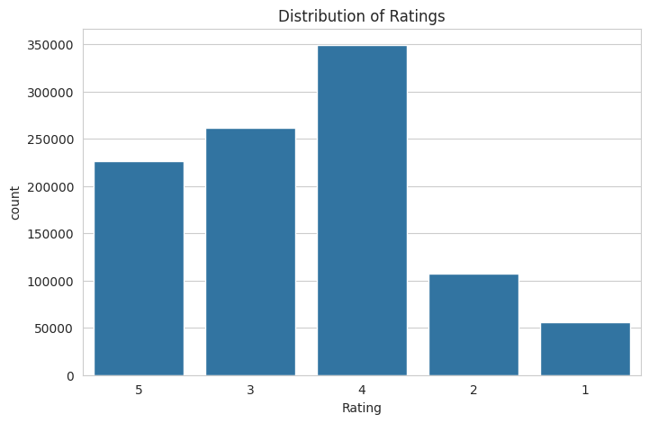
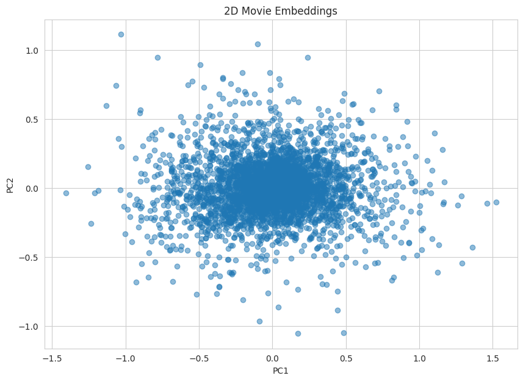
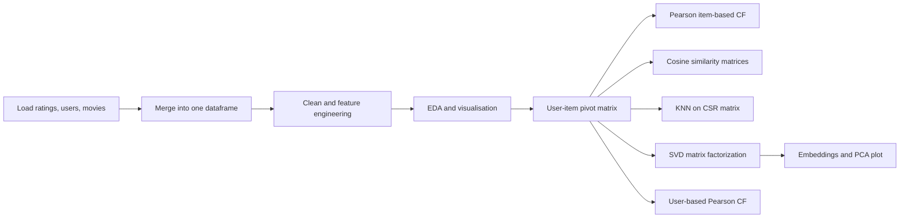
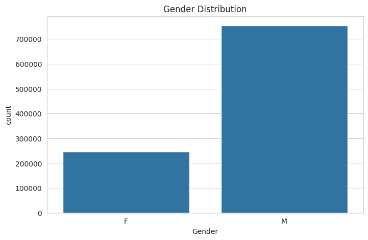
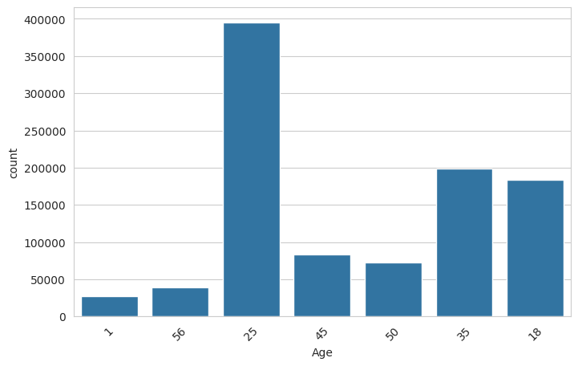
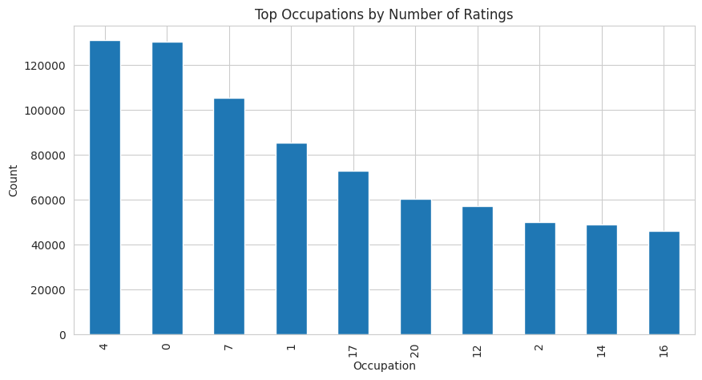
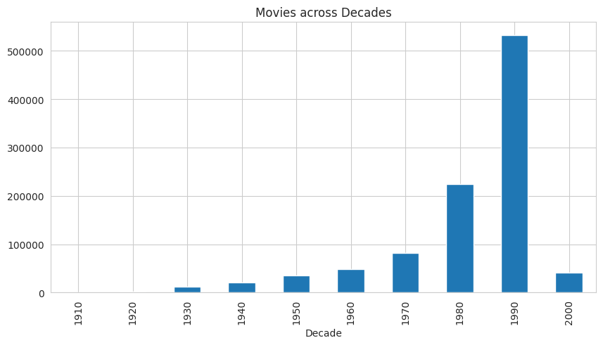
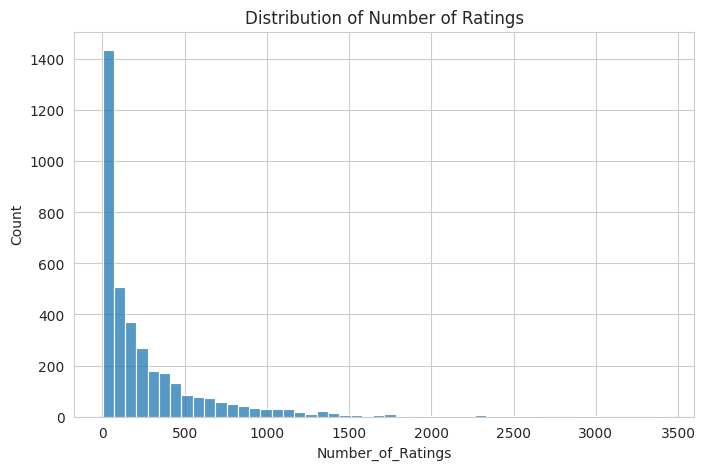
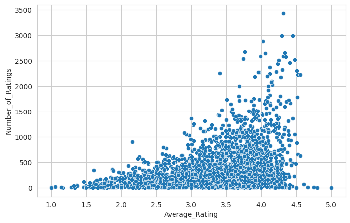

<div align="center">

# 🎬 Zee Recommender Systems

### Personalized movie recommendations with Collaborative Filtering, KNN and Matrix Factorization (SVD)

[](https://colab.research.google.com/github/<your-username>/<your-repo>/blob/main/zee-recommender-systems.ipynb)


<br>




</div>

---

## 📌 Table of Contents

- [Overview](#-overview)
- [Key Results](#-key-results)
- [Dataset](#-dataset)
- [Project Workflow](#-project-workflow)
- [Exploratory Data Analysis](#-exploratory-data-analysis)
- [Models](#-models)
- [Sample Recommendations](#-sample-recommendations)
- [Insights and Business Recommendations](#-insights-and-business-recommendations)
- [Case Study Q&A](#-case-study-qa)
- [Getting Started](#-getting-started)
- [Repository Structure](#-repository-structure)
- [Limitations and Future Work](#-limitations-and-future-work)
- [Tech Stack](#-tech-stack)
- [Author](#-author)

---

## 🧭 Overview

**Zee** wants to improve user experience and engagement by helping viewers discover movies that match their taste. This project builds, compares and evaluates several **collaborative filtering** recommenders on **1,000,209 ratings** given by **6,040 users** to **3,706 movies**.

| # | Approach | Idea |
|---|----------|------|
| 1 | **Item-based CF with Pearson correlation** | Recommend movies whose rating patterns correlate with a chosen movie |
| 2 | **Cosine similarity matrices** | Full item-item (3,706 x 3,706) and user-user (6,040 x 6,040) similarity |
| 3 | **KNN on a sparse CSR matrix** | Brute-force nearest neighbours with cosine distance |
| 4 | **Matrix Factorization (SVD, d = 4)** | Learn latent user and movie embeddings, evaluated with RMSE and MAPE |
| 5 | **User-based CF with Pearson correlation** | Rate a few movies as a new user and get recommendations from similar users |

**Business objectives**
- Understand user behaviour and movie preferences.
- Build collaborative-filtering recommenders and compare approaches.
- Evaluate the matrix factorization model using RMSE and MAPE.
- Generate personalized recommendations that improve customer experience and engagement.

---

## 🏆 Key Results

| Metric | Value |
|--------|-------|
| Ratings / Users / Rated movies | 1,000,209 / 6,040 / 3,706 |
| User-item matrix sparsity | **95.5%** (only ~4.5% of cells hold a rating) |
| **SVD RMSE** (d = 4, 80/20 split) | **0.8830** |
| **SVD MAPE** (d = 4, 80/20 split) | **0.2695** (about 27%) |
| Most-rated movie | *American Beauty (1999)*, 3,428 ratings |
| Top 3 movies similar to *Liar Liar (1997)* | *Mrs. Doubtfire*, *Dumb & Dumber*, *Ace Ventura: Pet Detective* |

---

## 🗂 Dataset

The data follows the [MovieLens 1M](https://grouplens.org/datasets/movielens/1m/) format and is included in this repository as three `::`-separated files.

| File | Schema | Rows | Description |
|------|--------|-----:|-------------|
| `zee-ratings.dat` | `UserID::MovieID::Rating::Timestamp` | 1,000,209 | 1-5 star whole-number ratings (Apr 2000 to Feb 2003), at least 20 per user |
| `zee-users.dat` | `UserID::Gender::Age::Occupation::Zip-code` | 6,040 | Voluntarily provided demographics |
| `zee-movies.dat` | `MovieID::Title::Genres` | 3,883 | IMDB titles (with release year) and pipe-separated genres; 3,706 of them have at least one rating |

**Age buckets:** `1` Under 18 | `18` 18-24 | `25` 25-34 | `35` 35-44 | `45` 45-49 | `50` 50-55 | `56` 56+
**Occupations:** 21 coded categories, for example `0` other, `4` college/grad student, `7` executive/managerial, `12` programmer, `17` technician/engineer.

> Each file begins with a header row, and `zee-movies.dat` needs `encoding='ISO-8859-1'`. See [Getting Started](#-getting-started) for a loading snippet.

---

## 🔄 Project Workflow



**Data preparation**
- Merged `ratings` + `users` on `UserID`, then merged with `movies` on `MovieID` into a single dataframe (1,000,209 rows x 10 columns).
- Verified there are no missing values and no duplicate rows, and converted `Rating` to numeric.
- Engineered **`Release_Year`** (regex on the title) and **`Decade`**.
- Aggregated per-movie **average rating** and **number of ratings**.
- Built a **6,040 x 3,706 user-item pivot table**, filled unrated cells with `0`, and converted it to a **CSR sparse matrix** (1,000,209 stored elements).

---

## 📊 Exploratory Data Analysis

| Question | Finding |
|----------|---------|
| Rating distribution | Positively skewed with an overall mean of **3.58**. 4 stars is the most common rating (34.9%), then 3 (26.1%) and 5 (22.6%). Only 5.6% of ratings are 1 star |
| Gender | **Male users dominate**: 753,769 ratings (75.4%) vs 246,440 from women (24.6%) |
| Age group | **25-34** contributes the most ratings (395,556, about 40%) |
| Occupation | **College/grad students (code 4)** rate the most (131,032), narrowly ahead of "other" (130,499) |
| Release decade | The **1990s** dominate: 532,843 ratings (about 53%) |
| Ratings per movie | Very long-tailed: median about 124, mean about 270, max 3,428 |
| Average movie rating | Mean of per-movie averages is 3.24, and most movies sit between about 2.8 and 3.7 |

<table>
  <tr>
    <td align="center"><br><sub><b>Gender distribution</b></sub></td>
    <td align="center"><br><sub><b>Ratings by age group</b></sub></td>
  </tr>
  <tr>
    <td align="center"><br><sub><b>Top 10 occupations by number of ratings</b></sub></td>
    <td align="center"><br><sub><b>Ratings by movie release decade</b></sub></td>
  </tr>
  <tr>
    <td align="center"><br><sub><b>Number of ratings per movie (long tail)</b></sub></td>
    <td align="center"><br><sub><b>Average rating vs popularity</b></sub></td>
  </tr>
</table>

**Most-rated movies**

| Movie | Avg. rating | # Ratings |
|-------|:-----------:|:---------:|
| American Beauty (1999) | 4.32 | 3,428 |
| Star Wars: Episode IV - A New Hope (1977) | 4.45 | 2,991 |
| Star Wars: Episode V - The Empire Strikes Back (1980) | 4.29 | 2,990 |
| Star Wars: Episode VI - Return of the Jedi (1983) | 4.02 | 2,883 |
| Jurassic Park (1993) | 3.76 | 2,672 |

---

## 🤖 Models

### 1. Item-based CF: Pearson correlation
`movie_pivot.corr(method='pearson')` produces a 3,706 x 3,706 correlation matrix. A helper returns the top-N most correlated movies for any title:

```python
def recommend_movies_pearson(movie_name, n=5):
    similar_movies = corr_matrix[movie_name].sort_values(ascending=False)
    return similar_movies.iloc[1:n+1]   # skip the movie itself

recommend_movies_pearson('Liar Liar (1997)')
```

### 2. Cosine similarity (item-item and user-user)
```python
item_similarity = cosine_similarity(movie_pivot.T)   # (3706, 3706)
user_similarity = cosine_similarity(movie_pivot)     # (6040, 6040)
```
Both are wrapped in labelled dataframes. The diagonal is 1 because every movie (or user) is identical to itself.

### 3. KNN with cosine distance on a CSR matrix
```python
item_csr = csr_matrix(movie_pivot.T.values)
knn = NearestNeighbors(metric='cosine', algorithm='brute').fit(item_csr)
distances, indices = knn.kneighbors(
    movie_pivot.T.iloc[movie_index, :].values.reshape(1, -1), n_neighbors=6
)
```

### 4. Matrix factorization: SVD (Surprise)
```python
reader = Reader(rating_scale=(1, 5))
data = Dataset.load_from_df(movie_df[['UserID', 'MovieID', 'Rating']], reader)
trainset, testset = train_test_split(data, test_size=0.2, random_state=42)

svd_model = SVD(n_factors=4, random_state=42).fit(trainset)
predictions = svd_model.test(testset)

accuracy.rmse(predictions)                                 # 0.8830
mean_absolute_percentage_error(actual, predicted)          # 0.2695
```

| Metric | Score | Interpretation |
|--------|:-----:|----------------|
| RMSE | **0.8830** | Predictions are off by roughly 0.9 stars on the 1-5 scale |
| MAPE | **0.2695** | About 27% average percentage error |

The learned latent factors are exposed as `svd_model.qi` (movie embeddings, 3,675 x 4) and `svd_model.pu` (user embeddings, 6,040 x 4). They are used for **embedding-based cosine similarity** and projected to 2D with **PCA** for visualisation.

> `qi` has 3,675 rows rather than 3,706 because the 80% training split does not contain every movie.

<div align="center">

<br><sub><b>PCA projection of the 4-dimensional movie embeddings</b>: a dense core around the origin with sparser outliers and no sharply separated clusters.</sub>
</div>

### 5. User-based CF: Pearson (new-user scenario)
1. Build a profile for a new user from five rated movies (*Toy Story*, *Jumanji*, *Heat*, *GoldenEye*, *Liar Liar*).
2. Find existing users who rated the same movies and keep the **top 100** by overlap.
3. Compute the **Pearson similarity** between the new user and each candidate who shares more than one movie.
4. Weight each neighbour's ratings by similarity and compute a **weighted average score** per movie.

---

## 🎯 Sample Recommendations

**Movies similar to *Liar Liar (1997)***

| Rank | Pearson correlation | Score | KNN (cosine) |
|:----:|---------------------|:-----:|--------------|
| 1 | Mrs. Doubtfire (1993) | 0.500 | Mrs. Doubtfire (1993) |
| 2 | Dumb & Dumber (1994) | 0.460 | Ace Ventura: Pet Detective (1994) |
| 3 | Ace Ventura: Pet Detective (1994) | 0.459 | Dumb & Dumber (1994) |
| 4 | Home Alone (1990) | 0.456 | Home Alone (1990) |
| 5 | Wedding Singer, The (1998) | 0.429 | Wayne's World (1992) |

Both methods agree strongly: they surface the same 90s slapstick-comedy cluster, which is a good sanity check for the item-based approach.

---

## 💡 Insights and Business Recommendations

**Insights**
- Male users dominate the rating data, and users aged 25-34 are the most active segment.
- Most rated movies come from the 1990s, and ratings skew positive.
- The user-item matrix is highly sparse (95.5%), and the long tail of rarely-rated movies makes similarity estimates noisy.
- Item-based Pearson and cosine similarity recover intuitive genre clusters, and matrix factorization captures latent taste patterns.

**Recommendations**
1. Use **Matrix Factorization** for personalized recommendations because it captures hidden user-movie relationships.
2. Promote popular, highly rated movies to **new users** who have no history (cold start).
3. Move towards a **hybrid recommender** that combines collaborative filtering with content features such as genres and release year.
4. Reuse the **movie embeddings** to power "more like this" features and downstream engines.
5. Add **demographics** (age, occupation) to enhance personalization.

---

## 📝 Case Study Q&A

<details>
<summary><b>Click to expand the questionnaire answers</b></summary>

| # | Question | Answer |
|---|----------|--------|
| 1 | Age group that rated the most movies? | **25-34** |
| 2 | Profession that rated the most movies? | **College/grad student** (occupation code 4) |
| 3 | Most users who rated are male. (T/F) | **True** |
| 4 | Decade with the most movies? | **1990s** |
| 5 | Movie with the maximum number of ratings? | **American Beauty (1999)** |
| 6 | Top 3 movies similar to *Liar Liar*? | **Mrs. Doubtfire (1993), Dumb & Dumber (1994), Ace Ventura: Pet Detective (1994)** |
| 7 | CF methods by approach? | **User-based** and **Item-based** |
| 8 | Range of Pearson correlation and cosine similarity? | Pearson: **-1 to +1**. Cosine: **0 to 1** for non-negative ratings (-1 to +1 in general) |
| 9 | RMSE and MAPE of the MF model? | **RMSE = 0.8830**, **MAPE = 0.2695** |
| 10 | CSR (sparse row) form of `[[1, 0], [3, 7]]`? | `data = [1, 3, 7]`, `indices = [0, 0, 1]`, `indptr = [0, 1, 3]` |

</details>

---

## 🚀 Getting Started

### Option A: Run on Google Colab
Click the **Open in Colab** badge at the top. The notebook was developed on Colab and mounts Google Drive, so either upload the three `.dat` files to your Drive at `MyDrive/colab-notebooks/zee-recommendations/` or change the paths as shown below.

### Option B: Run locally

**1. Clone the repository**
```bash
git clone https://github.com/<your-username>/<your-repo>.git
cd <your-repo>
```

**2. Install dependencies**
```bash
python -m venv venv
source venv/bin/activate        # Windows: venv\Scripts\activate
pip install numpy pandas matplotlib seaborn scipy scikit-learn scikit-surprise jupyter
```
> If `scikit-surprise` fails to build, install it with conda instead: `conda install -c conda-forge scikit-surprise`.

**3. Point the notebook at the local data files**
The data files sit next to the notebook, so skip the `drive.mount(...)` cell and load them like this:

```python
ratings = pd.read_csv('zee-ratings.dat', sep='::', engine='python', header=0,
                      names=['UserID', 'MovieID', 'Rating', 'Timestamp'])
users   = pd.read_csv('zee-users.dat', sep='::', engine='python', header=0,
                      names=['UserID', 'Gender', 'Age', 'Occupation', 'ZipCode'])
movies  = pd.read_csv('zee-movies.dat', sep='::', engine='python', header=0,
                      names=['MovieID', 'Title', 'Genres'], encoding='ISO-8859-1')
```
Using `header=0` treats the first line of each file as the header, so every column gets its proper numeric dtype.

**4. Launch the notebook**
```bash
jupyter notebook zee-recommender-systems.ipynb
```

---

## 📁 Repository Structure

```
.
├── zee-recommender-systems.ipynb   # Full analysis: EDA, CF models, KNN, SVD, user-based CF
├── zee-ratings.dat                 # 1,000,209 ratings (UserID::MovieID::Rating::Timestamp)
├── zee-users.dat                   # 6,040 users with demographics
├── zee-movies.dat                  # 3,883 movies with titles and genres
├── images/                         # Plots used in this README
└── README.md
```

---

## 🔭 Limitations and Future Work

This project is a solid baseline. These are the most valuable next steps:

- **Zero imputation:** treating "unrated" as a rating of `0` biases Pearson and cosine similarity towards popular titles. Try mean-centering, adjusted cosine, or similarity computed on observed ratings only.
- **Minimum-ratings threshold:** item-based correlations for movies with very few ratings are noisy. Filter to movies with a minimum number of ratings (for example 50+).
- **User-based CF robustness:** with only 2-5 movies in common, similarity scores are unstable. The current weighted average sums positive and negative similarities, which can cancel out and produce `inf` or scores above 5 (the top two results are `inf`, and the next scores are 465 and 254). Fix this by keeping only positive similarities, requiring a minimum overlap, excluding movies the user already rated, and requiring a minimum number of contributing neighbours per movie.
- **Embedding-based recommenders:** map the SVD embedding similarity matrix back to movie titles (via `trainset.to_raw_iid`) and wrap it in a `recommend(movie_name)` function like the Pearson one.
- **True d = 2 embeddings:** train `SVD(n_factors=2)` directly and compare the plot against PCA, t-SNE and UMAP projections of the d = 4 embeddings.
- **Stronger evaluation:** add k-fold cross-validation, hyperparameter tuning (`GridSearchCV` over `n_factors`, `lr_all`, `reg_all`), a baseline model such as the global mean, and ranking metrics like Precision@K, Recall@K and NDCG.
- **Cold start and hybrid models:** blend collaborative filtering with content signals (genres, release year) and demographics.

**Roadmap**

- [x] EDA and feature engineering
- [x] Item-based CF (Pearson and cosine)
- [x] KNN with CSR sparse matrix
- [x] SVD matrix factorization with RMSE and MAPE
- [x] User-based CF for a new user
- [ ] Embedding-based `recommend()` function
- [ ] Hyperparameter tuning and cross-validation
- [ ] Hybrid recommender
- [ ] Streamlit demo app

---

## 🛠 Tech Stack

| Purpose | Libraries |
|---------|-----------|
| Data handling | `pandas`, `numpy` |
| Visualisation | `matplotlib`, `seaborn` |
| Similarity and KNN | `scikit-learn` (`cosine_similarity`, `NearestNeighbors`) |
| Sparse matrices | `scipy.sparse` (`csr_matrix`) |
| Matrix factorization | `scikit-surprise` (`SVD`) |
| Dimensionality reduction | `scikit-learn` (`PCA`) |

---

## 👤 Author

**Your Name**
[LinkedIn](https://www.linkedin.com/in/your-profile) | [GitHub](https://github.com/your-username) | your.email@example.com

---

<div align="center">

If you found this project useful, please consider giving it a star ⭐

</div>
