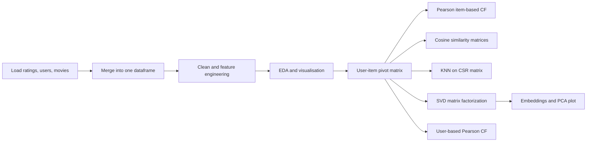

<div align="center">

# 🎬 Zee Movie Recommender System

### Personalized movie recommendations using Collaborative Filtering, KNN and Matrix Factorization (SVD)


</div>

---

## 📌 Table of Contents

- [Overview](#-overview)
- [Key Results](#-key-results)
- [Dataset](#-dataset)
- [Project Workflow](#-project-workflow)
- [Methodology](#-methodology)
- [Exploratory Data Analysis](#-exploratory-data-analysis)
- [Sample Recommendations](#-sample-recommendations)
- [Case Study Q&A](#-case-study-qa)
- [Getting Started](#-getting-started)
- [Repository Structure](#-repository-structure)
- [Limitations & Future Work](#-limitations--future-work)
- [Tech Stack](#-tech-stack)
- [Author](#-author)

---

## 🧭 Overview

**Zee** wants to improve user experience and engagement by showing each viewer movies they are likely to enjoy. This project builds and compares several **collaborative filtering** recommenders on a dataset of **1,000,209 ratings** from **6,040 users** across **3,706 movies**.

The recommender engine is built in five stages:

| # | Approach | Idea |
|---|----------|------|
| 1 | **Item-based CF with Pearson correlation** | Recommend movies whose rating patterns correlate with a chosen movie |
| 2 | **Item-based and user-based CF with cosine similarity** | Build full item-item and user-user similarity matrices |
| 3 | **KNN on a sparse CSR matrix** | Brute-force nearest neighbours with cosine distance |
| 4 | **Matrix Factorization (SVD, d = 4)** | Learn latent user and movie embeddings, evaluated with RMSE and MAPE |
| 5 | **User-based CF with Pearson correlation** | Rate a few movies as a new user and get recommendations from similar users |

---

## 🏆 Key Results

| Metric | Value |
|--------|-------|
| Ratings / Users / Movies | 1,000,209 / 6,040 / 3,706 |
| User-item matrix sparsity | ~95.5% (only ~4.5% of cells are filled) |
| **SVD RMSE** (d = 4, 80/20 split) | **0.8830** |
| **SVD MAPE** (d = 4, 80/20 split) | **0.2695 (~27%)** |
| Most-rated movie | *American Beauty (1999)* with 3,428 ratings |
| Top 3 movies similar to *Liar Liar* | *Mrs. Doubtfire*, *Dumb & Dumber*, *Ace Ventura: Pet Detective* |

---

## 🗂 Dataset

The data follows the [MovieLens 1M](https://grouplens.org/datasets/movielens/1m/) format and consists of three `::`-separated files:

| File | Schema | Description |
|------|--------|-------------|
| `ratings.dat` | `UserID::MovieID::Rating::Timestamp` | 1-5 star whole-number ratings, at least 20 per user |
| `users.dat` | `UserID::Gender::Age::Occupation::Zip-code` | Voluntarily provided demographics |
| `movies.dat` | `MovieID::Title::Genres` | IMDB titles (with release year) and pipe-separated genres |

**Age buckets:** `1` Under 18, `18` 18-24, `25` 25-34, `35` 35-44, `45` 45-49, `50` 50-55, `56` 56+
**Occupations:** 21 coded categories (`0` other, `4` college/grad student, `7` executive/managerial, `12` programmer, ...)

> The files use `::` as a separator, so they are loaded with `pd.read_csv(..., sep='::', engine='python')`. `movies.dat` needs `encoding='ISO-8859-1'`.

---

## 🔄 Project Workflow



---

## 🧪 Methodology

### 1. Data preparation and feature engineering
- Merged `ratings` + `users` on `UserID`, then merged with `movies` on `MovieID` into one dataframe of **1,000,209 rows x 10 columns**.
- Checked for nulls and duplicates (none found) and converted `Rating` to numeric.
- Derived **`Release_Year`** (regex on the title) and **`Decade`** from it.
- Aggregated per-movie **average rating** and **number of ratings**.

### 2. User-item matrix
A pivot table of **6,040 users x 3,706 movies** with ratings as values. Missing ratings are imputed with `0`, and the matrix is later converted to a **CSR sparse matrix** (1,000,209 stored elements) for efficient computation.

### 3. Item-based CF: Pearson correlation
`movie_pivot.corr(method='pearson')` yields a 3,706 x 3,706 correlation matrix. A helper returns the top-N most correlated movies for any title:

```python
def recommend_movies_pearson(movie_name, n=5):
    similar_movies = corr_matrix[movie_name].sort_values(ascending=False)
    return similar_movies.iloc[1:n+1]   # skip the movie itself

recommend_movies_pearson('Liar Liar (1997)')
```

### 4. Cosine similarity and KNN
- Built the **item-item** (3,706 x 3,706) and **user-user** (6,040 x 6,040) cosine similarity matrices.
- Fitted `NearestNeighbors(metric='cosine', algorithm='brute')` on the transposed CSR matrix and queried the 5 nearest neighbours of a movie.

```python
item_csr = csr_matrix(movie_pivot.T.values)
knn = NearestNeighbors(metric='cosine', algorithm='brute').fit(item_csr)
distances, indices = knn.kneighbors(
    movie_pivot.T.iloc[movie_index, :].values.reshape(1, -1), n_neighbors=6
)
```

### 5. Matrix factorization with SVD (Surprise)
```python
reader  = Reader(rating_scale=(1, 5))
data    = Dataset.load_from_df(movie_df[['UserID', 'MovieID', 'Rating']], reader)
trainset, testset = train_test_split(data, test_size=0.2, random_state=42)

svd = SVD(n_factors=4, random_state=42).fit(trainset)
predictions = svd.test(testset)
accuracy.rmse(predictions)                                  # 0.8830
mean_absolute_percentage_error(actual, predicted)           # 0.2695
```

The learned latent factors are available as `svd.qi` (movie embeddings, 3,675 x 4) and `svd.pu` (user embeddings, 6,040 x 4). They are used for embedding-based cosine similarity and projected to 2D with **PCA** for visualisation.

> `svd.qi` has 3,675 rows rather than 3,706 because the 80% training split does not contain every movie.

### 6. User-based CF: Pearson (new-user scenario)
1. Create a profile for a new user from a few rated movies.
2. Find existing users who rated the same movies and keep the **top 100** by overlap.
3. Compute the **Pearson similarity** between the new user and each candidate.
4. Rank by similarity, weight neighbours' ratings by similarity, and compute a **weighted average score** per movie.

---

## 📊 Exploratory Data Analysis

| Question | Finding |
|----------|---------|
| Rating distribution | Skewed positive. **4 stars** is the most common rating (348,971), followed by 3 and 5 |
| Gender | **Male users dominate**: 753,769 ratings vs 246,440 from women (~75%) |
| Age group | **25-34** contributes the most ratings (395,556, ~40%) |
| Occupation | **College/grad students (code 4)** rate the most (131,032), closely followed by "other" (130,499) |
| Release decade | **1990s** dominate the data (532,843 ratings, ~53%) |
| Ratings per movie | Highly long-tailed: median ~124, mean ~270, max 3,428 |
| Average movie rating | Mean 3.24, most movies fall between ~2.8 and ~3.7 |

**Most-rated movies**

| Movie | Avg. Rating | # Ratings |
|-------|:-----------:|:---------:|
| American Beauty (1999) | 4.32 | 3,428 |
| Star Wars: Episode IV - A New Hope (1977) | 4.45 | 2,991 |
| Star Wars: Episode V - The Empire Strikes Back (1980) | 4.29 | 2,990 |
| Star Wars: Episode VI - Return of the Jedi (1983) | 4.02 | 2,883 |
| Jurassic Park (1993) | 3.76 | 2,672 |

---

## 🎯 Sample Recommendations

**Movies similar to *Liar Liar (1997)***

| Rank | Pearson correlation | Score | KNN (cosine) |
|:----:|---------------------|:-----:|--------------|
| 1 | Mrs. Doubtfire (1993) | 0.500 | Mrs. Doubtfire (1993) |
| 2 | Dumb & Dumber (1994) | 0.460 | Ace Ventura: Pet Detective (1994) |
| 3 | Ace Ventura: Pet Detective (1994) | 0.459 | Dumb & Dumber (1994) |
| 4 | Home Alone (1990) | 0.456 | Home Alone (1990) |
| 5 | Wedding Singer, The (1998) | 0.429 | Wayne's World (1992) |

Both methods agree strongly: they surface the same 90s slapstick-comedy cluster, which is a good sanity check for the item-based approach.

---

## 📝 Case Study Q&A

<details>
<summary><b>Click to expand the questionnaire answers</b></summary>

| # | Question | Answer |
|---|----------|--------|
| 1 | Age group that rated the most movies? | **25-34** |
| 2 | Profession that rated the most movies? | **College/grad student** (occupation code 4) |
| 3 | Most users who rated are male. (T/F) | **True** |
| 4 | Decade with the most movies? | **1990s** |
| 5 | Movie with the maximum number of ratings? | **American Beauty (1999)** |
| 6 | Top 3 movies similar to *Liar Liar*? | **Mrs. Doubtfire (1993), Dumb & Dumber (1994), Ace Ventura: Pet Detective (1994)** |
| 7 | CF methods by approach? | **User-based** and **Item-based** |
| 8 | Range of Pearson correlation and cosine similarity? | Pearson: **-1 to +1**. Cosine: **0 to 1** (for non-negative ratings) |
| 9 | RMSE and MAPE of the MF model? | **RMSE = 0.8830**, **MAPE = 0.2695** |
| 10 | CSR (sparse row) form of `[[1, 0], [3, 7]]`? | `data = [1, 3, 7]`, `indices = [0, 0, 1]`, `indptr = [0, 1, 3]` |

</details>

---

## 🚀 Getting Started

### 1. Clone the repository
```bash
git clone https://github.com/<your-username>/zee-recommender-system.git
cd zee-recommender-system
```

### 2. Install dependencies
```bash
python -m venv venv
source venv/bin/activate        # Windows: venv\Scripts\activate
pip install -r requirements.txt
```

<details>
<summary><b>requirements.txt</b></summary>

```text
numpy
pandas
matplotlib
seaborn
scipy
scikit-learn
scikit-surprise
jupyter
```

</details>

> **Tip:** if `scikit-surprise` fails to build on your machine, install it with conda instead: `conda install -c conda-forge scikit-surprise`.

### 3. Add the data
Download the dataset and place the three files in a `data/` folder:

```
data/
├── ratings.dat
├── users.dat
└── movies.dat
```

Then update the file paths in the loading cells of the notebook. The original notebook was run on Google Colab and reads from Google Drive, so replace those paths (for example `data/ratings.dat`) and remove the `drive.mount(...)` cell if you run it locally.

### 4. Run the notebook
```bash
jupyter notebook notebooks/zee_recommender_system.ipynb
```

---

## 📁 Repository Structure

```
zee-recommender-system/
├── data/                              # ratings.dat, users.dat, movies.dat (not tracked)
├── notebooks/
│   └── zee_recommender_system.ipynb   # full analysis and models
├── reports/
│   └── zee_recommender_system.pdf     # exported notebook (47 pages)
├── requirements.txt
└── README.md
```

---

## 🔭 Limitations & Future Work

This project is a solid baseline, and these are the most valuable next steps:

- **Zero imputation:** treating "unrated" as a rating of `0` biases Pearson and cosine similarity toward popular titles. Try mean-centering, adjusted cosine, or similarity on observed ratings only.
- **Minimum-ratings threshold:** item-based correlations for movies with very few ratings are noisy. Filter to movies with a minimum number of ratings (for example, 50+).
- **User-based CF robustness:** with only 2-5 movies in common, similarity scores are unstable, and negative and positive similarities can cancel out to produce `inf` weighted averages. Use only positive similarities, set a minimum overlap, exclude movies the user has already rated, and require a minimum number of contributing neighbours per movie.
- **Embedding-based recommenders:** map the SVD embedding similarity matrix back to movie titles (via `trainset.to_raw_iid`) and wrap it in a `recommend(movie_name)` function like the Pearson one.
- **True d = 2 embeddings:** train `SVD(n_factors=2)` directly and compare the plot against PCA / t-SNE / UMAP projections of the d = 4 embeddings.
- **Stronger evaluation:** add k-fold cross-validation, hyperparameter tuning (`GridSearchCV` over `n_factors`, `lr_all`, `reg_all`), a baseline model, and ranking metrics such as Precision@K, Recall@K and NDCG.
- **Cold start and hybrid models:** blend collaborative filtering with content-based signals (genres, release year) and user demographics (age, occupation).

**Roadmap**

- [x] EDA and feature engineering
- [x] Item-based CF (Pearson and cosine)
- [x] KNN with CSR sparse matrix
- [x] SVD matrix factorization with RMSE and MAPE
- [x] User-based CF for a new user
- [ ] Embedding-based `recommend()` function
- [ ] Hyperparameter tuning and cross-validation
- [ ] Hybrid recommender
- [ ] Streamlit demo app

---

## 🛠 Tech Stack

| Purpose | Libraries |
|---------|-----------|
| Data handling | `pandas`, `numpy` |
| Visualisation | `matplotlib`, `seaborn` |
| Similarity and KNN | `scikit-learn` (`cosine_similarity`, `NearestNeighbors`) |
| Sparse matrices | `scipy.sparse` (`csr_matrix`) |
| Matrix factorization | `scikit-surprise` (`SVD`) |
| Dimensionality reduction | `scikit-learn` (`PCA`) |

---

## 👤 Author

**Your Name**
[LinkedIn](https://www.linkedin.com/in/aditya-putsala) | [GitHub](https://github.com/aditya-putsala) | adityaputsala@example.com

---

<div align="center">

If you found this project useful, please consider giving it a star ⭐

</div>
